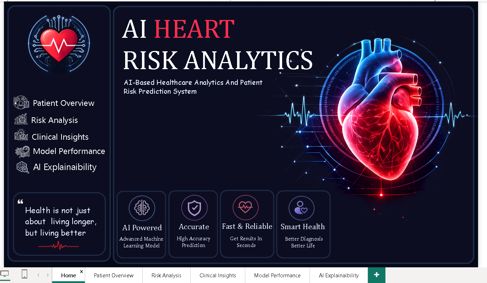
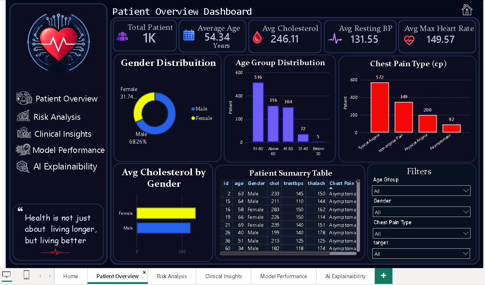
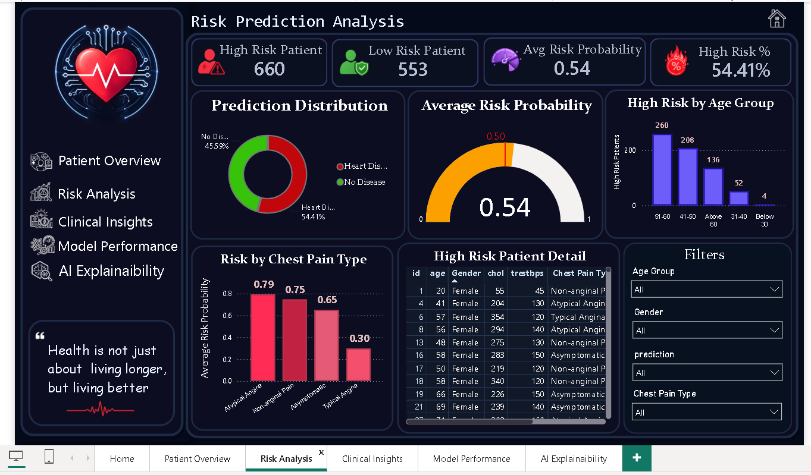
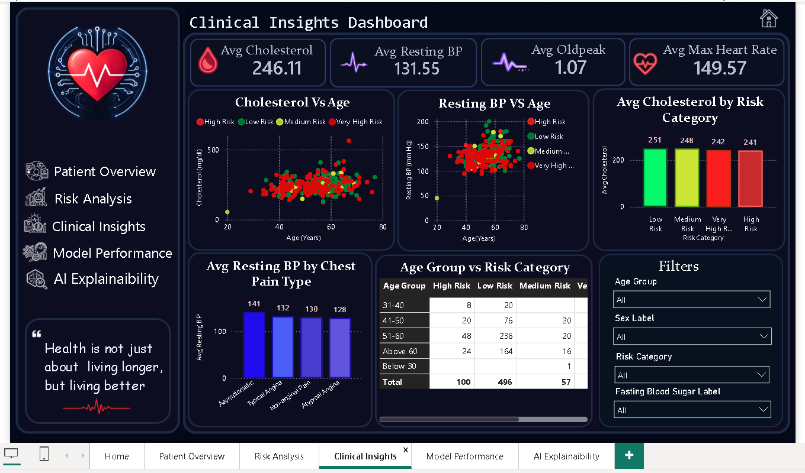
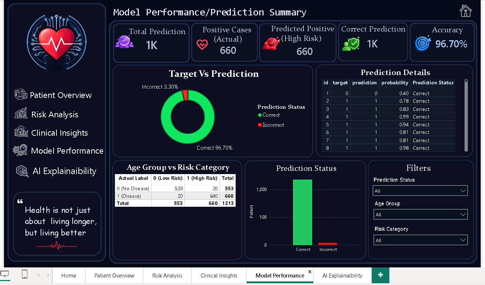
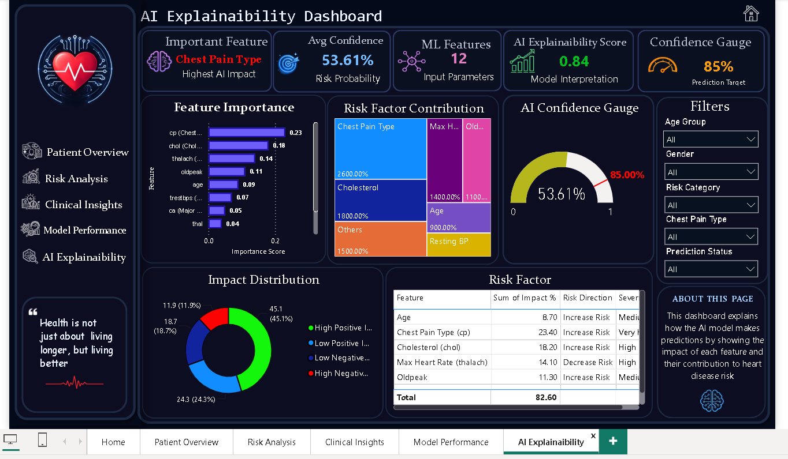
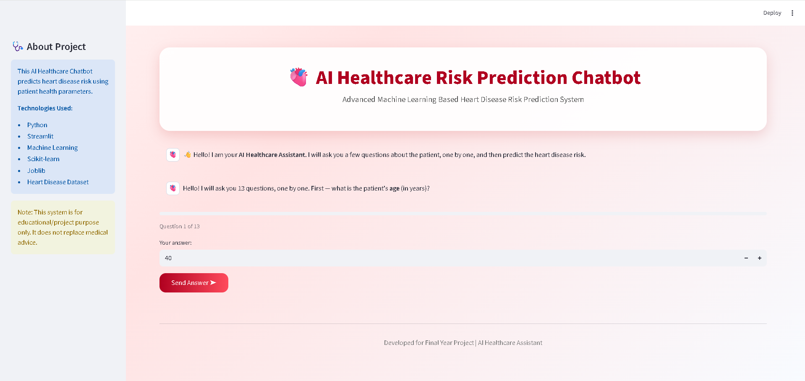
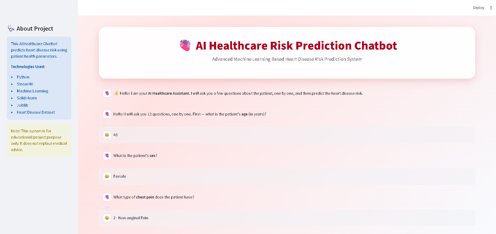
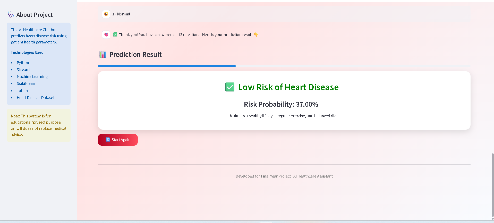

## AI Heart Risk Analytics

## Overview

AI Heart Risk Analytics is a Machine Learning-based healthcare analytics project that predicts heart disease risk using patient health data.

The project integrates Python, PostgreSQL, Streamlit, and Power BI to provide predictive insights and interactive visualizations.

## Dashboard Screenshots

### 1. Home



### 2. Patient Overview



### 3. Risk Analysis



### 4. Clinical Insights



### 5. Model Performance



### 6. AI Explainability



## Chatbot Screenshots

### 1. Chat Start



### 2. One-by-One Questions



### 3. Prediction Result



## How to Run the Chatbot

1. Open the `heart_prediction_chatbot` folder.
2. Make sure `heart_model.pkl` is in the same folder.
3. Run:

```
streamlit run app_chatbot.py
```

The chatbot asks 13 questions one by one — age, sex, chest pain type, resting blood pressure, cholesterol, fasting blood sugar, resting ECG, maximum heart rate, exercise-induced angina, oldpeak, slope, major vessels, and thalassemia — and then shows the heart disease risk prediction with its probability.

## Features

- Heart Disease Risk Prediction
- Conversational Chatbot that asks 13 health questions one by one
- Interactive Power BI Dashboard
- Streamlit-based Web Application
- PostgreSQL Database Integration
- Data Cleaning and Preprocessing
- Machine Learning Model Training and Evaluation

## Technologies Used

- Python
- Machine Learning
- PostgreSQL
- Streamlit
- Power BI
- Pandas
- NumPy
- Scikit-learn

## Project Files

- `ml_code.ipynb` – Machine Learning Model Development
- `heart_model.pkl` – Trained Model
- `dashboard.pbix` – Power BI Dashboard
- `Heart_disease.sql` – Database Script
- `cleaned_heart.csv` – Processed Dataset
- `heart_prediction_chatbot/app_chatbot.py` – Conversational Chatbot (asks 13 questions one by one)
- `heart_prediction_chatbot/app_modified.py` – Original Form-based Application
- `heart_prediction_chatbot/heart_model.pkl` – Trained Model for the apps

## Workflow

1. Data Collection
2. Data Cleaning & Preprocessing
3. Model Training
4. Model Evaluation
5. Database Integration
6. Dashboard Development
7. Streamlit Deployment

## Results

The project predicts heart disease risk and provides interactive analytics through Power BI and a Streamlit-based healthcare assistant.

The Model Performance dashboard shows an accuracy of **83.61%**.
